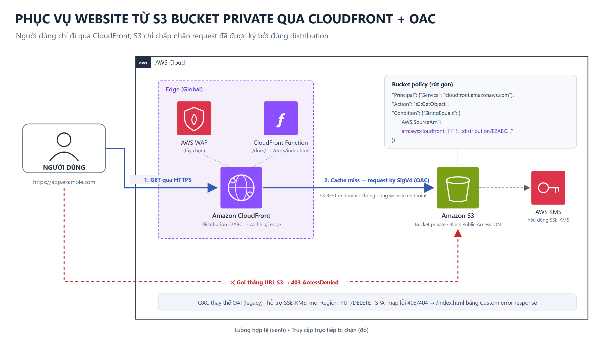

Here's a common way to put a frontend (React, Vue, a static Next.js export…) on AWS: build it into a dist/ folder, upload that to Amazon S3, turn on Static website hosting, turn off Block Public Access, and add a bucket policy that lets `"Principal": "*"` read the objects.

The site works right away. Then a couple of questions come up:

- Anyone can call the bucket URL directly and skip the CDN, the WAF and the HTTPS on your real domain. Is that okay?
- Is there a way to keep the bucket fully private and still have the website work for users?

The usual answer is to put Amazon CloudFront in front and use Origin Access Control (OAC). But how does OAC work, and why do so many people get 403 AccessDenied right after turning it on?



### 1. What is OAC?

Origin Access Control lets CloudFront send authenticated requests to an S3 origin. With OAC set to Sign requests (recommended), CloudFront signs every request it sends to S3 and always uses HTTPS between CloudFront and S3 [1].

On the S3 side, the bucket policy only lets the service principal `cloudfront.amazonaws.com` read objects, with a condition that `AWS:SourceArn` matches the ARN of your distribution:

```json
"Principal": { "Service": "cloudfront.amazonaws.com" },
"Action": "s3:GetObject",
"Resource": "arn:aws:s3:::your-bucket/*",
"Condition": {
  "StringEquals": {
    "AWS:SourceArn": "arn:aws:cloudfront::111122223333:distribution/E2ABC..."
  }
}
```

What you get:

- Users coming through the CloudFront domain → allowed.
- Someone calling the S3 URL directly → 403 AccessDenied.
- A different CloudFront distribution → also denied, because the SourceArn doesn't match.

The bucket can keep Block Public Access: ON and doesn't need any public permissions.

### 2. How is OAC different from OAI?

CloudFront used to use Origin Access Identity (OAI). AWS now calls OAI legacy and recommends OAC, because OAC supports [1]:

- Every S3 bucket in every AWS Region, including opt-in Regions launched after December 2022.
- Objects encrypted with SSE-KMS.
- Dynamic requests such as PUT and DELETE to S3.

If you're on OAI today, you can move over step by step: update the bucket policy to allow both OAI and OAC, switch the distribution to OAC, wait for the deploy to finish, and only then remove the OAI statement. CloudFront keeps access to the bucket the whole time.

### 3. Common mistake #1: using the S3 website endpoint as the origin

S3 has two kinds of endpoint, and picking the wrong one is the most common mistake:

- REST endpoint: `your-bucket.s3.<region>.amazonaws.com`
- Website endpoint: `your-bucket.s3-website-<region>.amazonaws.com`

If the origin is the website endpoint, CloudFront has to treat it as a custom origin, and then you can't use OAC (or OAI) [1]. The website endpoint only serves public content.

For a private bucket with OAC, the origin has to be the REST endpoint, and you can turn Static website hosting off on the bucket.

### 4. Common mistake #2: refreshing an SPA sub-page gives 403

After moving to the REST endpoint with OAC, the home page works, but when a user refreshes on /dashboard they get a 403 instead of the page.

The reason: there's no object called dashboard in the bucket. Because CloudFront doesn't have `s3:ListBucket`, S3 returns 403 AccessDenied instead of 404 for an object that doesn't exist [3]. That's sensible from a security point of view (it doesn't reveal which objects exist), but it means the client-side router never gets a chance to run.

Two common fixes:

- For an SPA: set up a Custom error response on the distribution that maps 403 (and 404) → /index.html with response code 200 [4].
- For a static site with many folders (docs, blogs): the Default root object only applies to the root URL, so a request for a sub-folder like /docs/ doesn't return index.html on its own [5]. A CloudFront Function on viewer request can rewrite /docs/ to /docs/index.html.

Note: mapping 403 → index.html for the whole distribution also hides real 403 errors (a missing KMS permission, for example). When debugging, check the CloudFront logs or turn the error response off for a while to see the real error.

### 5. Common mistake #3: SSE-KMS objects are still denied

If the bucket uses SSE-KMS with a customer managed key, the bucket policy alone isn't enough. CloudFront also needs permission to use the KMS key to decrypt objects.

Add a statement to the key policy for the service principal `cloudfront.amazonaws.com` with `kms:Decrypt` (plus `kms:Encrypt` and `kms:GenerateDataKey*` if you upload through CloudFront), with an `AWS:SourceArn` condition for your distribution [1].

Without it, the symptom is still a 403. And if you already set up the error response from section 04, you may only see index.html and have no idea why the real file won't load.

### 6. Deploying a new version: cache and invalidation

With CloudFront in front, content is cached at the edge. Uploading a new build to S3 doesn't mean users see it right away.

A common approach:

- Files with a hash in the name (main.3f9a1c.js, style.8b2e.css): cache for a long time, for example `Cache-Control: max-age=31536000, immutable`.
- index.html: short cache or no-cache, so the browser always gets the version that points to the new files.
- After a deploy, invalidating /index.html is enough, because the hashed files already have new names.

On cost: the first 1,000 invalidation paths each month (across the whole account) are free, and after that you pay per path. A wildcard path like /* counts as one path [6]. So you invalidate selectively mainly to avoid wiping the whole cache and sending every request back to the origin right after each deploy; the money is usually small.

### 7. Checklist before going to production

- Is the origin the S3 REST endpoint and not the website endpoint?
- Is Block Public Access on, with a bucket policy that only allows cloudfront.amazonaws.com with the right distribution in AWS:SourceArn?
- Is OAC set to Sign requests (recommended)?
- If you use SSE-KMS, does the key policy let the distribution decrypt?
- Is the viewer protocol policy Redirect HTTP to HTTPS or HTTPS only?
- Does the SPA have an error response, and does a multi-folder site have a way to rewrite to index.html?
- Is the caching plan for hashed files and index.html clear?

### Conclusion

S3 static website hosting is the fastest way to get a frontend onto AWS, but it forces the bucket to be public.

CloudFront with OAC splits the roles cleanly. CloudFront is the only way in, with HTTPS, caching and (optionally) WAF. S3 is just private storage that accepts requests signed by the right distribution.

Most problems when moving to OAC come from the details around it: the wrong endpoint, 403 instead of 404, KMS permissions and caching. Once you know these, a website runs fine from a private bucket.

### References

1. [Restrict access to an Amazon S3 origin (OAC)](https://docs.aws.amazon.com/AmazonCloudFront/latest/DeveloperGuide/private-content-restricting-access-to-s3.html)
2. [Use various origins with CloudFront distributions](https://docs.aws.amazon.com/AmazonCloudFront/latest/DeveloperGuide/DownloadDistS3AndCustomOrigins.html)
3. [Amazon S3 API: GetObject (permissions)](https://docs.aws.amazon.com/AmazonS3/latest/API/API_GetObject.html)
4. [Generate custom error responses](https://docs.aws.amazon.com/AmazonCloudFront/latest/DeveloperGuide/GeneratingCustomErrorResponses.html)
5. [Specify a default root object](https://docs.aws.amazon.com/AmazonCloudFront/latest/DeveloperGuide/DefaultRootObject.html)
6. [Pay for file invalidation](https://docs.aws.amazon.com/AmazonCloudFront/latest/DeveloperGuide/PayingForInvalidation.html)
7. [FCAJ Workshop: Content Delivery with Amazon CloudFront](https://000094.awsfcaj.com/)
