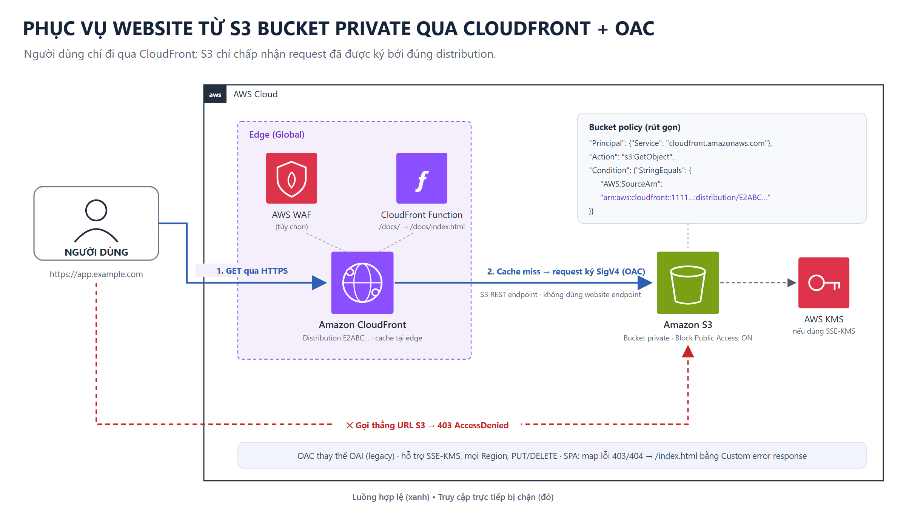

Một tình huống quen thuộc khi deploy frontend (React, Vue, Next.js export tĩnh…) lên AWS: build ra thư mục dist/, upload lên Amazon S3, bật Static website hosting, tắt Block Public Access và thêm bucket policy cho phép `"Principal": "*"` đọc object.

Website chạy ngay. Nhưng sau đó sẽ có vài câu hỏi:

- Ai cũng có thể gọi thẳng URL của bucket, bỏ qua CDN, WAF và HTTPS của domain chính?
- Có cách nào để bucket vẫn private hoàn toàn mà người dùng vẫn truy cập website bình thường không?

Câu trả lời phổ biến là đặt Amazon CloudFront phía trước và dùng Origin Access Control (OAC). Nhưng OAC thực sự hoạt động thế nào, và vì sao nhiều người bật xong lại gặp 403 AccessDenied?



### 1. OAC là gì?

Origin Access Control là cơ chế để CloudFront gửi request đã được xác thực tới S3 origin. Khi bật OAC với chế độ Sign requests (recommended), CloudFront ký mọi request gửi tới S3 và luôn dùng HTTPS giữa CloudFront và S3 [1].

Phía S3, bucket policy chỉ cho phép service principal `cloudfront.amazonaws.com` đọc object, kèm điều kiện `AWS:SourceArn` phải đúng ARN của distribution:

```json
"Principal": { "Service": "cloudfront.amazonaws.com" },
"Action": "s3:GetObject",
"Resource": "arn:aws:s3:::ten-bucket/*",
"Condition": {
  "StringEquals": {
    "AWS:SourceArn": "arn:aws:cloudfront::111122223333:distribution/E2ABC..."
  }
}
```

Kết quả:

- Người dùng truy cập qua domain CloudFront → hợp lệ.
- Ai đó gọi thẳng URL S3 → 403 AccessDenied.
- Một distribution CloudFront khác → cũng bị từ chối, vì SourceArn không khớp.

Bucket có thể giữ nguyên Block Public Access: ON, không cần cấp quyền public nào.

### 2. OAC khác gì OAI?

Trước đây CloudFront dùng Origin Access Identity (OAI). AWS hiện xếp OAI vào nhóm legacy và khuyến nghị dùng OAC vì OAC hỗ trợ [1]:

- Tất cả S3 bucket ở mọi AWS Region, kể cả các opt-in Region ra mắt sau tháng 12/2022.
- Object mã hóa bằng SSE-KMS.
- Request động như PUT và DELETE tới S3.

Nếu hệ thống đang dùng OAI, có thể chuyển dần: cập nhật bucket policy cho phép cả OAI và OAC, đổi distribution sang OAC, chờ deploy xong rồi mới xóa statement của OAI. Nhờ vậy CloudFront không mất quyền truy cập bucket trong lúc chuyển.

### 3. Lỗi thường gặp #1: dùng S3 website endpoint làm origin

S3 có hai kiểu endpoint, và chọn nhầm kiểu là lỗi hay gặp nhất:

- REST endpoint: `ten-bucket.s3.<region>.amazonaws.com`
- Website endpoint: `ten-bucket.s3-website-<region>.amazonaws.com`

Nếu origin là website endpoint, CloudFront phải cấu hình nó như một custom origin, và khi đó không dùng được OAC (hay OAI) [1]. Website endpoint chỉ phục vụ nội dung public.

Muốn bucket private + OAC thì origin phải là REST endpoint, và có thể tắt Static website hosting trên bucket.

### 4. Lỗi thường gặp #2: refresh trang con của SPA bị 403

Sau khi chuyển sang REST endpoint + OAC, trang chủ chạy bình thường, nhưng khi người dùng refresh ở /dashboard thì nhận 403 thay vì trang web.

Lý do: không có object nào tên dashboard trong bucket. Vì CloudFront không có quyền `s3:ListBucket`, S3 trả 403 AccessDenied thay vì 404 cho object không tồn tại [3]. Đây là hành vi hợp lý về bảo mật (không tiết lộ object nào có hay không có), nhưng khiến router phía client không có cơ hội chạy.

Hai hướng xử lý phổ biến:

- Với SPA: cấu hình Custom error response trên distribution, map 403 (và 404) → /index.html với response code 200 [4].
- Với site tĩnh nhiều thư mục (docs, blog): Default root object chỉ áp dụng cho URL gốc; request tới thư mục con như /docs/ không tự trả về index.html [5]. Có thể dùng CloudFront Function ở viewer request để viết lại /docs/ thành /docs/index.html.

Lưu ý: map 403 → index.html cho toàn bộ distribution sẽ "nuốt" cả các lỗi 403 thật (ví dụ thiếu quyền KMS). Khi debug, hãy kiểm tra CloudFront logs hoặc tạm tắt error response để thấy lỗi gốc.

### 5. Lỗi thường gặp #3: object mã hóa SSE-KMS vẫn bị từ chối

Nếu bucket dùng SSE-KMS với customer managed key, bucket policy thôi là chưa đủ. CloudFront còn cần quyền dùng KMS key để giải mã object.

Cần thêm statement vào key policy cho service principal `cloudfront.amazonaws.com` với `kms:Decrypt` (thêm `kms:Encrypt`, `kms:GenerateDataKey*` nếu có upload qua CloudFront), kèm điều kiện `AWS:SourceArn` đúng distribution [1].

Nếu thiếu bước này, triệu chứng vẫn là 403, và nếu đã bật error response ở mục 04, bạn có thể chỉ thấy trang index.html mà không biết vì sao file thật không tải được.

### 6. Deploy bản mới: cache và invalidation

Khi đặt CloudFront phía trước, nội dung được cache ở edge. Upload bản build mới lên S3 không có nghĩa người dùng thấy ngay.

Một chiến lược phổ biến:

- File có hash trong tên (main.3f9a1c.js, style.8b2e.css): cache dài, ví dụ `Cache-Control: max-age=31536000, immutable`.
- index.html: cache ngắn hoặc no-cache, để trình duyệt luôn lấy được bản trỏ tới file mới.
- Sau deploy, invalidation /index.html là đủ, vì file có hash đã mang tên mới.

Về chi phí: 1.000 invalidation path đầu tiên mỗi tháng (tính chung cho cả tài khoản) được miễn phí, sau đó tính phí theo path. Một path có wildcard như /* cũng chỉ tính là một path [6]. Vì vậy invalidation có chọn lọc chủ yếu để tránh xóa toàn bộ cache và dồn request về origin ngay sau mỗi lần deploy; tiền thường không đáng kể.

### 7. Checklist trước khi đưa lên production

- Origin là S3 REST endpoint, không phải website endpoint?
- Bucket bật Block Public Access, bucket policy chỉ cho phép cloudfront.amazonaws.com với AWS:SourceArn đúng distribution?
- OAC đặt ở chế độ Sign requests (recommended)?
- Nếu dùng SSE-KMS, key policy đã cho phép distribution giải mã?
- Viewer protocol policy là Redirect HTTP to HTTPS hoặc HTTPS only?
- SPA đã cấu hình error response; site nhiều thư mục đã có cơ chế rewrite index.html?
- Chiến lược cache cho file có hash và index.html đã rõ ràng?

### Kết luận

Static website hosting trên S3 là cách nhanh nhất để đưa frontend lên AWS, nhưng nó buộc bucket phải public.

CloudFront + OAC tách vai trò rõ ràng: CloudFront là cửa ngõ duy nhất với HTTPS, cache và (tùy chọn) WAF; S3 chỉ là kho lưu trữ private, chấp nhận request đã được ký bởi đúng distribution.

Phần lớn lỗi khi chuyển sang OAC đến từ những chi tiết xung quanh nó: chọn nhầm endpoint, 403 thay vì 404, quyền KMS và cache. Nắm được mấy điểm này thì website vẫn chạy bình thường với bucket private.

### Nguồn tham khảo

1. [Restrict access to an Amazon S3 origin (OAC)](https://docs.aws.amazon.com/AmazonCloudFront/latest/DeveloperGuide/private-content-restricting-access-to-s3.html)
2. [Use various origins with CloudFront distributions](https://docs.aws.amazon.com/AmazonCloudFront/latest/DeveloperGuide/DownloadDistS3AndCustomOrigins.html)
3. [Amazon S3 API: GetObject (permissions)](https://docs.aws.amazon.com/AmazonS3/latest/API/API_GetObject.html)
4. [Generate custom error responses](https://docs.aws.amazon.com/AmazonCloudFront/latest/DeveloperGuide/GeneratingCustomErrorResponses.html)
5. [Specify a default root object](https://docs.aws.amazon.com/AmazonCloudFront/latest/DeveloperGuide/DefaultRootObject.html)
6. [Pay for file invalidation](https://docs.aws.amazon.com/AmazonCloudFront/latest/DeveloperGuide/PayingForInvalidation.html)
7. [FCAJ Workshop: Content Delivery with Amazon CloudFront](https://000094.awsfcaj.com/)
