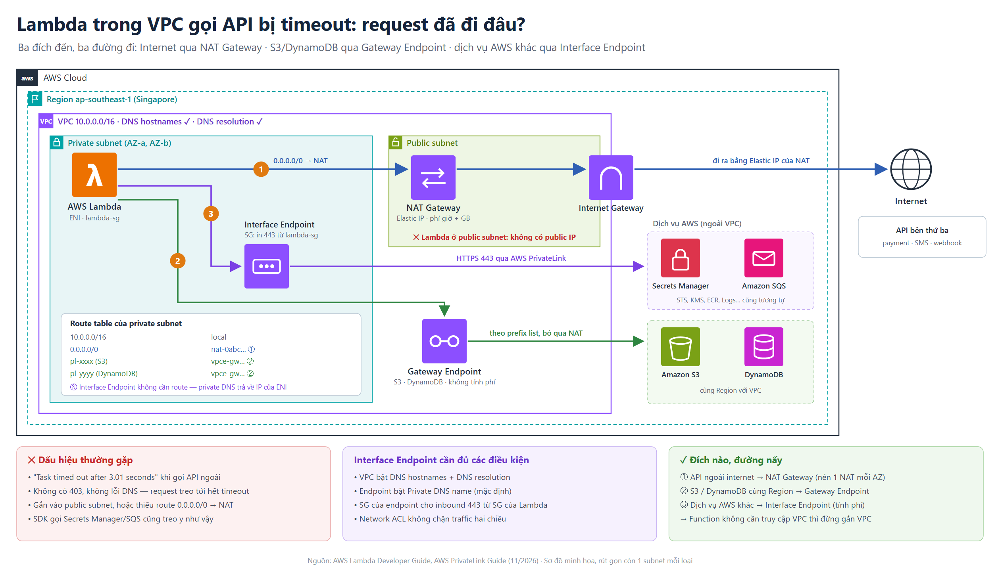

This one comes up all the time in serverless work.

An order-processing Lambda needs to read data from Amazon RDS in a private subnet. To reach the database, the Lambda gets attached to the VPC. The RDS connection works.

But right away, things that used to work break:

- Calling the external payment gateway API → hangs.
- Getting a password from AWS Secrets Manager → hangs.
- Sending a message to Amazon SQS → hangs.

The logs show no 403 and no DNS error. Just one line:

```text
Task timed out after 3.01 seconds
```

The first instinct is usually to raise the timeout, raise the memory, or move the Lambda to a public subnet so it "has internet". The last one sounds reasonable but fixes nothing.



### 1. Without a VPC, Lambda already has internet

Every Lambda function runs inside a VPC that Lambda itself owns and manages, which customers can't see. By default, the function can reach the internet [1].

When you add a VPC configuration, Lambda creates a Hyperplane ENI in the subnet and security group you pick. From then on, the function can only reach what your VPC allows, unless that VPC has a route to the internet [1].

In other words, once you attach a VPC, the way out is yours to manage.

A few things to know when attaching a VPC:

- The execution role needs permission to create and manage ENIs, which the managed policy AWSLambdaVPCAccessExecutionRole includes [1].
- A new function stays in the Pending state and can't be invoked until the Hyperplane ENI is ready, which can take a few minutes [1].
- Functions that share the same subnet and security group combination can share an ENI.

### 2. Why does it still time out in a public subnet?

With EC2, putting an instance in a public subnet and giving it a public IP gets it onto the internet. Many people assume the same works for Lambda.

But the Lambda docs say clearly that connecting a function to a public subnet doesn't give it internet access or a public IP [1]. The Hyperplane ENI only has a private IP, so even with a 0.0.0.0/0 → Internet Gateway route in the route table, the request can't get out.

What AWS recommends [2]:

- Put the Lambda in a private subnet.
- Create a NAT Gateway in a public subnet (with an Elastic IP).
- Private subnet route table: 0.0.0.0/0 → NAT Gateway.
- Public subnet route table: 0.0.0.0/0 → Internet Gateway.
- The Lambda's security group allows outbound traffic.

For IPv6 on a dual-stack subnet, the private subnet also needs a ::/0 → Egress-only Internet Gateway route [2].

### 3. Not every destination needs to go through NAT

With NAT in place, everything works again. But now every request, including calls to S3, DynamoDB, Secrets Manager and SQS, goes the long way through the NAT Gateway, which charges per hour and per GB processed.

It's better to split by destination:

- External APIs on the internet (payment, SMS, webhooks…) → NAT Gateway. If the destination is outside AWS, there's no other way.

- Amazon S3 and DynamoDB in the same Region → Gateway Endpoint. A route for the service's prefix list is added to the route table, traffic goes straight to the service without NAT, and Gateway Endpoints cost nothing extra [3].

- Other AWS services (Secrets Manager, SQS, STS, KMS, CloudWatch Logs…) → Interface Endpoint (AWS PrivateLink). The endpoint creates an ENI with a private IP in your subnet and is charged per hour and per GB processed [4].

Interface Endpoints don't need any extra routes. With Private DNS on, the service's default hostname (for example `secretsmanager.ap-southeast-1.amazonaws.com`) resolves to the endpoint's private IP, so code using the AWS SDK doesn't need any changes [4].

### 4. The Interface Endpoint exists but it still times out?

It's also common to create the endpoint and still have the SDK hang. Check these in order:

- VPC DNS: to use private DNS, the VPC needs both DNS hostnames and DNS resolution turned on [4]. Otherwise the service hostname still resolves to a public IP and the request goes looking for the internet again.
- Private DNS name on the endpoint: for services other than S3 it's on by default, and AWS recommends leaving it on [4].
- The endpoint's security group: it has to allow inbound HTTPS (443) from the caller, here the Lambda's security group [4]. If you don't pick one, the endpoint gets the VPC's default security group.
- The subnet's Network ACL must not block traffic between the Lambda and the endpoint's ENI [4].
- Endpoint subnets: you can pick one subnet per AZ. Create the endpoint in the AZs where the Lambda runs.

A quick debugging trick: write a test Lambda in the same subnet and security group and do a DNS lookup on the service hostname. A 10.x.x.x result means private DNS works. A public IP means you should go back and check the VPC and endpoint DNS settings.

### 5. Does the Lambda really need a VPC?

It's worth asking this before any of the steps above. A Lambda only needs a VPC when it has to reach resources inside one: RDS, ElastiCache, EC2, internal services behind an internal load balancer…

If the function only calls S3, DynamoDB, SQS, Secrets Manager and external APIs, leaving it out of the VPC is usually simplest: internet by default, no NAT, no endpoints, no ENIs to worry about.

If only a small part of the logic needs the VPC, consider splitting it into two functions: one inside the VPC that only talks to the database, and one outside that handles the external API calls.

### 6. Checklist for putting Lambda in a VPC

- Does the function really need to reach resources inside the VPC?
- Is the Lambda in private subnets across at least 2 AZs?
- If it needs the internet: a NAT Gateway in a public subnet, and a 0.0.0.0/0 → NAT route in the private subnet's route table?
- Do S3 and DynamoDB have Gateway Endpoints so they skip the NAT?
- Do other AWS services have Interface Endpoints, or is going through NAT acceptable?
- Does the VPC have DNS hostnames and DNS resolution on, and does the endpoint's SG allow 443 from the Lambda's SG?
- Can the execution role create ENIs (AWSLambdaVPCAccessExecutionRole or an equivalent policy)?

### Conclusion

A "Task timed out" right after attaching a VPC is rarely a code bug or a lack of resources. Most of the time, the request just can't find a way out.

Once a Lambda is in a VPC, each destination needs its own path: the internet through a NAT Gateway, S3 and DynamoDB through a Gateway Endpoint, other AWS services through an Interface Endpoint.

Knowing where each request goes makes timeouts faster to fix, and keeps traffic to AWS services from taking the long way through NAT for no reason.

### References

1. [Giving Lambda functions access to resources in an Amazon VPC](https://docs.aws.amazon.com/lambda/latest/dg/configuration-vpc.html)
2. [Enable internet access for VPC-connected Lambda functions](https://docs.aws.amazon.com/lambda/latest/dg/configuration-vpc-internet.html)
3. [Gateway endpoints](https://docs.aws.amazon.com/vpc/latest/privatelink/gateway-endpoints.html)
4. [Access an AWS service using an interface VPC endpoint](https://docs.aws.amazon.com/vpc/latest/privatelink/create-interface-endpoint.html)
5. [FCAJ Workshop: Private Access to S3 with VPC Endpoints](https://000111.awsfcaj.com/)
