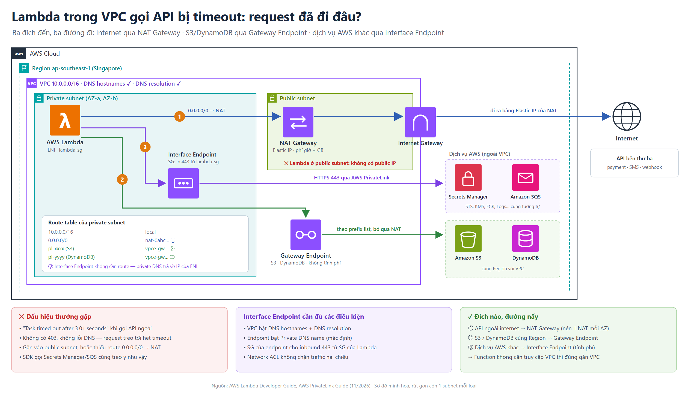

Một tình huống rất hay gặp khi làm serverless:

Một Lambda xử lý đơn hàng cần đọc dữ liệu từ Amazon RDS nằm trong private subnet. Để kết nối được database, Lambda được gắn vào VPC. Kết nối RDS chạy ổn.

Nhưng ngay sau đó, những phần trước đây vẫn chạy bình thường lại hỏng:

- Gọi API cổng thanh toán bên ngoài → treo.
- Lấy mật khẩu từ AWS Secrets Manager → treo.
- Gửi message vào Amazon SQS → treo.

Log không có 403, không có lỗi DNS. Chỉ có một dòng:

```text
Task timed out after 3.01 seconds
```

Phản xạ đầu tiên thường là tăng timeout, tăng memory, hoặc chuyển Lambda sang public subnet cho "có internet". Cách cuối cùng nghe hợp lý nhưng không giải quyết được gì.



### 1. Khi chưa gắn VPC, Lambda vẫn có internet

Mọi Lambda function đều chạy trong một VPC do chính Lambda sở hữu và quản lý, khách hàng không nhìn thấy VPC này. Mặc định, function có quyền truy cập internet [1].

Khi thêm cấu hình VPC, Lambda tạo Hyperplane ENI trong subnet + security group bạn chọn. Từ lúc đó, function chỉ truy cập được những gì VPC của bạn cho phép, trừ khi VPC đó có đường ra internet [1].

Nói cách khác, gắn VPC xong thì đường ra ngoài của Lambda do bạn tự quản lý.

Vài lưu ý khi gắn VPC:

- Execution role cần quyền tạo và quản lý ENI, có sẵn trong managed policy AWSLambdaVPCAccessExecutionRole [1].
- Function mới sẽ ở trạng thái Pending, chưa invoke được, cho tới khi Hyperplane ENI sẵn sàng; việc này có thể mất vài phút [1].
- Các function dùng chung tổ hợp subnet + security group có thể dùng chung ENI.

### 2. Vì sao đưa Lambda sang public subnet vẫn timeout?

Với EC2, đặt instance vào public subnet và gán public IP là ra được internet. Nhiều người áp dụng y nguyên cho Lambda.

Nhưng tài liệu Lambda ghi rõ: kết nối function vào public subnet không cho nó quyền truy cập internet hay public IP [1]. Hyperplane ENI chỉ có IP private, nên dù route table có 0.0.0.0/0 → Internet Gateway, request vẫn không ra được internet.

Cách AWS hướng dẫn [2]:

- Đặt Lambda vào private subnet.
- Tạo NAT Gateway trong public subnet (có Elastic IP).
- Route table của private subnet: 0.0.0.0/0 → NAT Gateway.
- Route table của public subnet: 0.0.0.0/0 → Internet Gateway.
- Security group của Lambda cho phép outbound.

Với IPv6 trên dual-stack subnet, private subnet cần thêm route ::/0 → Egress-only Internet Gateway [2].

### 3. Không phải đích đến nào cũng cần đi qua NAT

Sau khi thêm NAT, mọi thứ chạy lại. Nhưng lúc này mọi request, kể cả gọi S3, DynamoDB, Secrets Manager hay SQS, đều đi vòng qua NAT Gateway, vốn tính phí theo giờ và theo dung lượng dữ liệu xử lý.

Nên tách theo đích đến:

- API bên ngoài internet (payment, SMS, webhook…) → NAT Gateway. Đích nằm ngoài AWS thì không có đường nào khác.

- Amazon S3 và DynamoDB cùng Region → Gateway Endpoint. Route theo prefix list của dịch vụ được thêm vào route table, traffic đi thẳng tới dịch vụ, không qua NAT, và Gateway Endpoint không tính thêm phí [3].

- Các dịch vụ AWS khác (Secrets Manager, SQS, STS, KMS, CloudWatch Logs…) → Interface Endpoint (AWS PrivateLink). Endpoint tạo một ENI có IP private trong subnet của bạn, tính phí theo giờ và theo dữ liệu xử lý [4].

Interface Endpoint không cần thêm route. Khi bật Private DNS, tên miền mặc định của dịch vụ (ví dụ `secretsmanager.ap-southeast-1.amazonaws.com`) sẽ trả về IP private của endpoint, nên code dùng AWS SDK không phải sửa gì [4].

### 4. Interface Endpoint đã tạo mà vẫn timeout?

Tạo endpoint xong mà SDK vẫn treo cũng là chuyện hay gặp. Kiểm tra lần lượt:

- DNS của VPC: để dùng private DNS, VPC phải bật cả DNS hostnames và DNS resolution [4]. Nếu không, tên miền dịch vụ vẫn trả về IP public và request lại đi tìm đường ra internet.
- Private DNS name trên endpoint: với các dịch vụ khác S3, tùy chọn này bật sẵn và AWS khuyến nghị giữ nguyên [4].
- Security group của endpoint: phải cho phép inbound HTTPS (443) từ resource gọi tới, ở đây là security group của Lambda [4]. Nếu không chọn, endpoint gắn security group default của VPC.
- Network ACL của subnet không chặn traffic giữa Lambda và ENI của endpoint [4].
- Subnet của endpoint: mỗi AZ chọn được một subnet. Nên tạo endpoint ở các AZ mà Lambda đang chạy.

Mẹo debug nhanh: viết một Lambda test trong cùng subnet + security group, thực hiện DNS lookup tên miền dịch vụ. Kết quả là IP 10.x.x.x nghĩa là private DNS đã hoạt động; nếu là IP public, hãy quay lại kiểm tra DNS của VPC và endpoint.

### 5. Lambda có thực sự cần VPC không?

Đáng lẽ nên hỏi câu này trước mọi bước ở trên. Lambda chỉ cần gắn VPC khi phải truy cập tài nguyên nằm trong VPC: RDS, ElastiCache, EC2, service nội bộ sau internal load balancer…

Nếu function chỉ gọi S3, DynamoDB, SQS, Secrets Manager và API bên ngoài, không gắn VPC thường là lựa chọn đơn giản nhất: có internet mặc định, không NAT, không endpoint, không lo ENI.

Nếu chỉ một phần nhỏ logic cần vào VPC, có thể cân nhắc tách thành hai function: một function trong VPC chỉ làm việc với database, một function ngoài VPC lo phần gọi API bên ngoài.

### 6. Checklist khi gắn Lambda vào VPC

- Function có thực sự cần truy cập tài nguyên trong VPC không?
- Lambda đặt ở private subnet, ít nhất 2 AZ?
- Nếu cần internet: NAT Gateway ở public subnet, route 0.0.0.0/0 → NAT trong route table của private subnet?
- S3/DynamoDB đã có Gateway Endpoint để không đi vòng qua NAT?
- Các dịch vụ AWS khác đã có Interface Endpoint, hoặc chấp nhận đi qua NAT?
- VPC bật DNS hostnames + DNS resolution; SG của endpoint cho phép 443 từ SG của Lambda?
- Execution role có quyền tạo ENI (AWSLambdaVPCAccessExecutionRole hoặc policy tương đương)?

### Kết luận

"Task timed out" sau khi gắn VPC hiếm khi là lỗi code hay thiếu tài nguyên. Phần lớn trường hợp, request không tìm được đường ra.

Khi Lambda nằm trong VPC, mỗi đích đến cần một đường đi riêng: internet qua NAT Gateway, S3/DynamoDB qua Gateway Endpoint, các dịch vụ AWS khác qua Interface Endpoint.

Hiểu đường đi của từng request giúp sửa lỗi timeout nhanh hơn, đồng thời tránh để traffic tới các dịch vụ AWS đi vòng qua NAT một cách không cần thiết.

### Nguồn tham khảo

1. [Giving Lambda functions access to resources in an Amazon VPC](https://docs.aws.amazon.com/lambda/latest/dg/configuration-vpc.html)
2. [Enable internet access for VPC-connected Lambda functions](https://docs.aws.amazon.com/lambda/latest/dg/configuration-vpc-internet.html)
3. [Gateway endpoints](https://docs.aws.amazon.com/vpc/latest/privatelink/gateway-endpoints.html)
4. [Access an AWS service using an interface VPC endpoint](https://docs.aws.amazon.com/vpc/latest/privatelink/create-interface-endpoint.html)
5. [FCAJ Workshop: Private Access to S3 with VPC Endpoints](https://000111.awsfcaj.com/)
