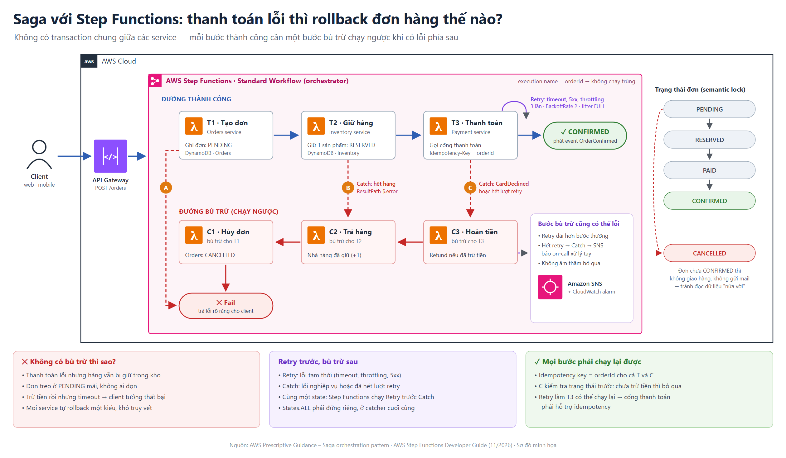

This comes up a lot when moving from a monolith to microservices.

Creating the order, taking stock and recording the payment used to live in one database. BEGIN TRANSACTION … COMMIT was enough, and any error meant ROLLBACK for everything.

After splitting into services, each part has its own database:

- The Orders service writes the order to the Orders table.
- The Inventory service reserves stock in the Inventory table.
- The Payment service calls an external payment gateway.

One day, order #1042 is created and the stock is reserved, but the payment fails because the card is declined. The order is stuck in PENDING, and the last item in stock is "locked" for an order that will never complete.

There's no shared transaction to ROLLBACK anymore. So how does the system undo its own work?



### 1. Why can't we use a transaction like before?

A relational database guarantees ACID within one database. When data spans several databases owned by several services, the traditional answer is two-phase commit (2PC): a coordinator asks every participant to "promise" to commit, and only then commits for real.

AWS Prescriptive Guidance points out that with database-per-service, 2PC isn't an option, because there's no shared coordinator across different data stores [1]. On top of that, an external payment gateway won't take part in your transaction anyway.

The common answer is the Saga pattern: split the big transaction into a chain of small steps, each one a local transaction in its own service. For every step, prepare a compensating transaction that "undoes it in business terms" if something fails later.

### 2. Orchestration: let Step Functions conduct

There are two ways to run a saga:

- Choreography: services publish and listen to each other's events.
- Orchestration: a central orchestrator knows every step and decides what runs next.

AWS suggests an AWS Step Functions Standard Workflow as the orchestrator [1]. For the order example:

Success path:

```text
T1 Create order (PENDING) → T2 Reserve stock (RESERVED) → T3 Charge payment (PAID) → CONFIRMED
```

Compensation path, running backwards:

- Failure at T1 → Fail, nothing to undo yet.
- Failure at T2 → C2 Release stock (if it was reserved) → C1 Cancel order → Fail.
- Failure at T3 → C3 Refund (if money was taken) → C2 Release stock → C1 Cancel order → Fail.

The rule: compensate in reverse order, and each compensating step checks for itself whether there's anything to undo.

Why Standard and not Express? Standard Workflows run exactly-once (unless you configure Retry), keep execution history and can run for up to a year, which suits non-idempotent work like payments. Express Workflows are at-least-once (async) or at-most-once (sync) and run for five minutes at most [3].

Also, if you set the execution name to the orderId, a Standard Workflow won't start a new execution with the same name while the old one is still running [3]. That's one layer of protection against duplicate sagas when a customer clicks "Place order" twice.

### 3. Retry and Catch for two different kinds of error

Not every error needs a rollback. Step Functions gives a Task state two tools [2]:

Retry, for temporary errors: timeouts, throttling, 5xx from the payment gateway.

```json
"Retry": [{
  "ErrorEquals": ["Payment.Timeout", "Lambda.TooManyRequestsException"],
  "IntervalSeconds": 2,
  "MaxAttempts": 3,
  "BackoffRate": 2,
  "JitterStrategy": "FULL"
}]
```

Catch, for business errors or when retries run out: a declined card, out of stock.

```json
"Catch": [{
  "ErrorEquals": ["CardDeclined"],
  "ResultPath": "$.error",
  "Next": "RefundPayment"
}, {
  "ErrorEquals": ["States.ALL"],
  "ResultPath": "$.error",
  "Next": "RefundPayment"
}]
```

A few details worth knowing [2]:

- When a state has both Retry and Catch, Step Functions retries first and only moves to Catch if retrying doesn't fix it.
- The defaults are MaxAttempts = 3 and BackoffRate = 2.0. JitterStrategy: FULL keeps retries from all landing at the same moment.
- States.ALL has to be alone in ErrorEquals and sit in the last catcher.
- Without a ResultPath, the error output replaces the whole input. Set `ResultPath: "$.error"` to keep orderId, paymentId and so on for the compensating steps.

### 4. Retry can run the payment step twice

Say the Lambda calls the payment gateway, the gateway takes the money, but the response times out. Step Functions sees an error and retries T3. Without any safeguard, the customer is charged twice.

Standard Workflow's exactly-once only promises that a state won't run again outside your Retry settings [3]. Once you turn Retry on, you've allowed T3 to run again yourself.

That's why AWS stresses that saga participants must be idempotent so they can safely run again after temporary errors [1]. In the example:

- T3 sends Idempotency-Key = orderId (if the payment gateway supports it).
- T2 reserves stock with a conditional write keyed on orderId, so repeated calls don't take more stock.
- T1 creates the order with PutItem and an attribute_not_exists condition.

### 5. Compensating steps can fail too

A refund is also a call to an external API, so it can time out too.

A few rules for compensating transactions:

- Idempotent: refunding twice must not pay the money back twice. Before refunding, check whether the charge happened and whether it was already refunded.
- Handle "nothing to undo": if T3 failed before charging, C3 checks the status and skips.
- Retry longer than normal steps: a failed compensation means your data is inconsistent right now.
- Never fail silently: when retries run out, Catch into a state that sends to Amazon SNS or raises an alarm so the ops team can fix it by hand.

### 6. A saga has no isolation

While a saga is running, data across the services is "half done": the order exists but isn't paid, the stock is reserved but not sold.

AWS notes that sagas lack transaction isolation and recommends a semantic lock [1]. A simple way is to use the order status as a business lock:

```text
PENDING → RESERVED → PAID → CONFIRMED
(failure at any step) → CANCELLED
```

Other parts of the system (shipping, confirmation emails, revenue reports) only act on orders that are CONFIRMED. Orders in PENDING or RESERVED aren't final yet.

A saga also gives you eventual consistency, not strong consistency. Agree with the business side that for a short time the stock shown may not match exactly [1].

### 7. Checklist before a saga goes to production

- Does every step T have a matching compensating step C, run in reverse order?
- Are temporary errors (Retry) kept apart from business errors (Catch)?
- Does Catch use ResultPath to keep the data the compensating steps need?
- Are all T and C steps idempotent, even when retried?
- Does a failed compensating step raise an alarm, with a manual process to fix it?
- Do other systems only read orders that are final?
- Is logging/X-Ray on for the state machine so each saga can be traced?

### Conclusion

Once you move to microservices, rolling back has to be designed into the business flow as compensating steps.

Saga orchestration with Step Functions puts the whole success path and compensation path in one place you can see, retry and trace. But Step Functions only coordinates. Correctness still lives in each service: every step has to be safe to run again, and every compensating step has to handle the case where there's nothing to undo.

A saga needs Retry for temporary errors, Catch for business errors and idempotency in every step. Without all three, the saga itself can leave the data inconsistent.

### References

1. [AWS Prescriptive Guidance: Saga orchestration pattern](https://docs.aws.amazon.com/prescriptive-guidance/latest/cloud-design-patterns/saga-orchestration.html)
2. [Handling errors in Step Functions workflows](https://docs.aws.amazon.com/step-functions/latest/dg/concepts-error-handling.html)
3. [Choosing workflow type in Step Functions](https://docs.aws.amazon.com/step-functions/latest/dg/choosing-workflow-type.html)
4. [FCAJ Workshop: Workflow Orchestration with AWS Step Functions](https://000047.awsfcaj.com/)
