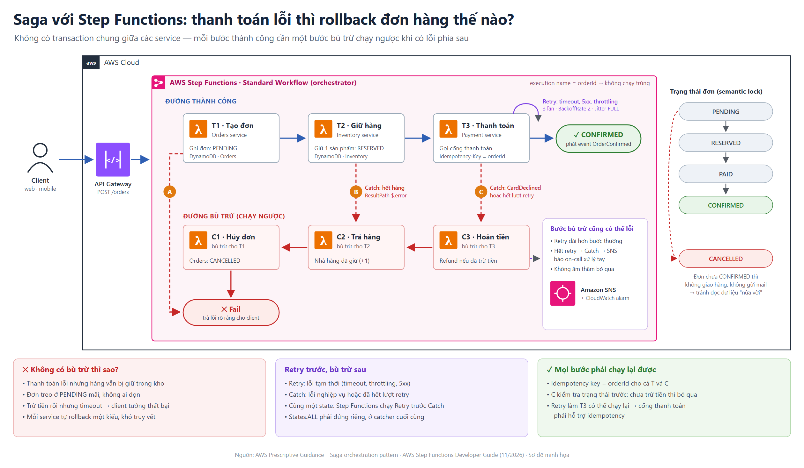

Chuyện này hay gặp khi chuyển từ monolith sang microservices.

Trước đây, tạo đơn, trừ kho và ghi nhận thanh toán nằm chung một database. Chỉ cần BEGIN TRANSACTION … COMMIT, lỗi ở đâu thì ROLLBACK toàn bộ.

Sau khi tách service, mỗi phần có database riêng:

- Orders service ghi đơn vào bảng Orders.
- Inventory service giữ hàng trong bảng Inventory.
- Payment service gọi cổng thanh toán bên ngoài.

Một ngày, đơn #1042 được tạo, hàng đã được giữ, nhưng thanh toán thất bại vì thẻ bị từ chối. Kết quả: đơn treo ở PENDING, sản phẩm cuối cùng trong kho bị "khóa" cho một đơn sẽ không bao giờ hoàn thành.

Không còn transaction chung để ROLLBACK. Vậy hệ thống phải tự quay lui như thế nào?



### 1. Vì sao không dùng được transaction như trước?

Cơ sở dữ liệu quan hệ đảm bảo ACID trong phạm vi một database. Khi dữ liệu trải qua nhiều database của nhiều service, cách truyền thống là two-phase commit (2PC): một coordinator yêu cầu tất cả bên tham gia "hứa" commit rồi mới commit thật.

AWS Prescriptive Guidance chỉ ra rằng với mô hình database-per-service, 2PC không phải là lựa chọn, vì không có một bộ điều phối chung cho các data store khác nhau [1]. Thêm vào đó, cổng thanh toán bên ngoài cũng không tham gia transaction của bạn.

Giải pháp phổ biến là Saga pattern: chia giao dịch lớn thành chuỗi bước nhỏ, mỗi bước là một local transaction trong service của nó. Với mỗi bước, chuẩn bị sẵn một bước bù trừ (compensating transaction) để "hoàn tác về mặt nghiệp vụ" nếu có lỗi ở phía sau.

### 2. Orchestration: để Step Functions làm nhạc trưởng

Saga có hai cách tổ chức:

- Choreography: các service tự phát và lắng nghe event của nhau.
- Orchestration: một orchestrator trung tâm biết toàn bộ các bước và quyết định chạy bước nào tiếp theo.

AWS gợi ý dùng AWS Step Functions Standard Workflow làm orchestrator [1]. Với ví dụ đơn hàng:

Đường thành công:

```text
T1 Tạo đơn (PENDING) → T2 Giữ hàng (RESERVED) → T3 Thanh toán (PAID) → CONFIRMED
```

Đường bù trừ, chạy ngược:

- Lỗi ở T1 → Fail, chưa có gì để bù.
- Lỗi ở T2 → C2 Trả hàng (nếu đã lỡ giữ) → C1 Hủy đơn → Fail.
- Lỗi ở T3 → C3 Hoàn tiền (nếu đã trừ) → C2 Trả hàng → C1 Hủy đơn → Fail.

Nguyên tắc: bù trừ theo thứ tự ngược lại, và mỗi bước bù trừ tự kiểm tra xem có gì cần hoàn tác hay không.

Vì sao chọn Standard thay vì Express? Standard Workflow thực thi theo mô hình exactly-once (trừ khi bạn cấu hình Retry), lưu lịch sử thực thi và có thể chạy tới một năm, phù hợp cho các tác vụ không idempotent như xử lý thanh toán. Express Workflow dùng at-least-once (bất đồng bộ) hoặc at-most-once (đồng bộ) và chỉ chạy tối đa năm phút [3].

Ngoài ra, nếu đặt execution name = orderId, Standard Workflow sẽ không khởi chạy execution mới cùng tên khi execution cũ đang chạy [3]. Đây là một lớp chống tạo saga trùng khi client bấm "Đặt hàng" hai lần.

### 3. Retry và Catch cho hai loại lỗi khác nhau

Không phải lỗi nào cũng cần rollback. Step Functions có hai cơ chế cho Task state [2]:

Retry, cho lỗi tạm thời: timeout, throttling, 5xx từ cổng thanh toán.

```json
"Retry": [{
  "ErrorEquals": ["Payment.Timeout", "Lambda.TooManyRequestsException"],
  "IntervalSeconds": 2,
  "MaxAttempts": 3,
  "BackoffRate": 2,
  "JitterStrategy": "FULL"
}]
```

Catch, cho lỗi nghiệp vụ hoặc khi đã hết lượt retry: thẻ bị từ chối, hết hàng.

```json
"Catch": [{
  "ErrorEquals": ["CardDeclined"],
  "ResultPath": "$.error",
  "Next": "RefundPayment"
}, {
  "ErrorEquals": ["States.ALL"],
  "ResultPath": "$.error",
  "Next": "RefundPayment"
}]
```

Một số chi tiết đáng chú ý [2]:

- Khi một state có cả Retry và Catch, Step Functions chạy Retry trước; chỉ khi retry không giải quyết được mới chuyển sang Catch.
- Mặc định MaxAttempts = 3, BackoffRate = 2.0. JitterStrategy: FULL giúp các lần retry không dồn cùng lúc.
- States.ALL phải đứng một mình trong ErrorEquals và nằm ở catcher cuối cùng.
- Nếu không đặt ResultPath, error output sẽ ghi đè toàn bộ input. Đặt `ResultPath: "$.error"` để giữ lại orderId, paymentId… cho các bước bù trừ phía sau.

### 4. Retry có thể làm bước thanh toán chạy hai lần

Giả sử Lambda gọi cổng thanh toán, cổng đã trừ tiền nhưng response bị timeout. Step Functions thấy lỗi và retry T3. Nếu không có biện pháp gì, khách hàng bị trừ tiền hai lần.

Exactly-once của Standard Workflow chỉ đảm bảo state không chạy lại ngoài cấu hình Retry của bạn [3]. Khi đã bật Retry, chính bạn đã cho phép T3 chạy lại.

Vì vậy AWS nhấn mạnh: các bên tham gia saga cần idempotent để có thể chạy lại an toàn khi gặp lỗi tạm thời [1]. Trong ví dụ:

- T3 gửi Idempotency-Key = orderId (nếu cổng thanh toán hỗ trợ).
- T2 giữ hàng bằng conditional write theo orderId, không trừ kho thêm mỗi lần gọi.
- T1 tạo đơn bằng PutItem với điều kiện attribute_not_exists.

### 5. Bước bù trừ cũng có thể lỗi

Hoàn tiền cũng là một lời gọi API ra bên ngoài, nên cũng có thể timeout.

Một vài nguyên tắc cho compensating transaction:

- Idempotent: hoàn tiền hai lần không được thành hoàn hai lần tiền. Trước khi hoàn, kiểm tra giao dịch đã được trừ chưa và đã hoàn chưa.
- Chịu được việc "không có gì để bù": nếu T3 thất bại trước khi trừ tiền, C3 kiểm tra trạng thái và bỏ qua.
- Retry dài hơn bước thường: bước bù trừ thất bại nghĩa là dữ liệu đang không nhất quán.
- Không âm thầm bỏ qua: khi hết retry, Catch sang một state gửi Amazon SNS hoặc tạo alarm để đội vận hành xử lý tay.

### 6. Saga không có isolation

Trong lúc saga đang chạy, dữ liệu ở các service đang ở trạng thái "nửa vời": đơn đã có nhưng chưa thanh toán, hàng đã giữ nhưng chưa bán.

AWS lưu ý saga thiếu transaction isolation và khuyến nghị dùng semantic lock [1]. Cách đơn giản là dùng trạng thái đơn như một khóa nghiệp vụ:

```text
PENDING → RESERVED → PAID → CONFIRMED
(lỗi ở bất kỳ bước nào) → CANCELLED
```

Các phần khác của hệ thống (giao hàng, gửi email xác nhận, báo cáo doanh thu) chỉ xử lý đơn ở trạng thái CONFIRMED. Đơn đang PENDING hay RESERVED được coi là chưa chốt.

Saga cũng mang lại eventual consistency, không phải strong consistency. Cần thống nhất với phía nghiệp vụ rằng trong một khoảng ngắn, tồn kho hiển thị có thể chưa khớp hoàn toàn [1].

### 7. Checklist trước khi đưa saga lên production

- Mỗi bước T đã có bước bù trừ C tương ứng, chạy theo thứ tự ngược?
- Đã phân biệt lỗi tạm thời (Retry) và lỗi nghiệp vụ (Catch)?
- Catch dùng ResultPath để giữ lại dữ liệu cần cho bước bù trừ?
- Mọi bước T và C idempotent, kể cả khi bị retry?
- Bước bù trừ thất bại có alarm và quy trình xử lý tay?
- Các hệ thống khác chỉ đọc đơn ở trạng thái đã chốt?
- Bật logging/X-Ray cho state machine để truy vết từng saga?

### Kết luận

Khi tách thành microservices, việc rollback phải được thiết kế thành từng bước bù trừ trong nghiệp vụ.

Saga orchestration với Step Functions giúp gom toàn bộ luồng thành công và luồng bù trừ vào một nơi có thể nhìn thấy, retry và truy vết. Nhưng Step Functions chỉ điều phối; tính đúng đắn vẫn nằm ở từng service: bước nào cũng phải chạy lại được an toàn, bước bù trừ nào cũng phải xử lý được trường hợp "không có gì để bù".

Saga cần đủ Retry cho lỗi tạm thời, Catch cho lỗi nghiệp vụ và idempotency ở mọi bước. Thiếu một thứ, chính saga có thể làm dữ liệu không nhất quán.

### Nguồn tham khảo

1. [AWS Prescriptive Guidance: Saga orchestration pattern](https://docs.aws.amazon.com/prescriptive-guidance/latest/cloud-design-patterns/saga-orchestration.html)
2. [Handling errors in Step Functions workflows](https://docs.aws.amazon.com/step-functions/latest/dg/concepts-error-handling.html)
3. [Choosing workflow type in Step Functions](https://docs.aws.amazon.com/step-functions/latest/dg/choosing-workflow-type.html)
4. [FCAJ Workshop: Workflow Orchestration with AWS Step Functions](https://000047.awsfcaj.com/)
